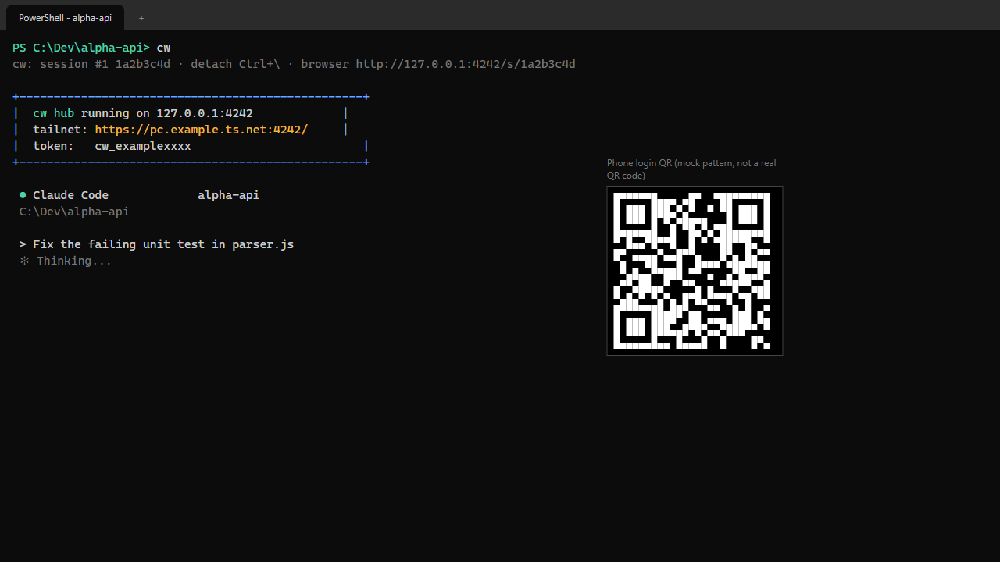
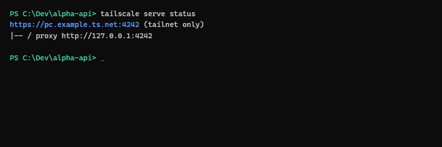
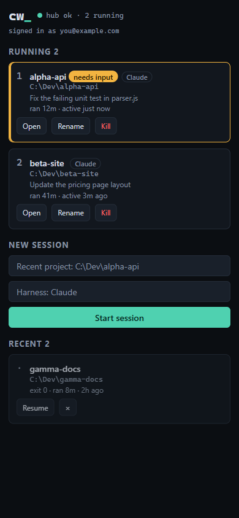
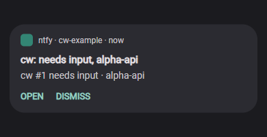

# Installing claude-web (`cw`)

This guide takes a new Windows 11 user from nothing to a working `cw`, with optional phone access, push notifications and an always-on hub. Every command below is taken from the [README](README.md), which stays the reference for details. For day-to-day tasks see [docs/HOWTO.md](docs/HOWTO.md).

> The screenshots in this guide are mock-ups with made-up data (sessions "alpha-api" and "beta-site", host `pc.example.ts.net`). They are not real captures.

## What you get

Run `cw` in a project folder and it starts Claude Code inside a small local hub and shows the session in your terminal. The same session can be opened from your phone over Tailscale, with a key bar, a compose box and permission approvals, and you can get a push notification (through ntfy) when Claude needs input or has finished.



## 1. Prerequisites

Required:

- **Windows 11.** Only Windows is tested.
- **Node.js 22 or later** (tested with Node 24). Check with `node --version`.
- **Git**, to clone the repository.
- **Claude Code** installed and logged in. Check that `claude --version` works and that you can start `claude` once and sign in.

Optional, only for the phone:

- **Tailscale** on the PC and on the phone, both signed in to the same tailnet. In the phone's Tailscale app, MagicDNS ("Use Tailscale DNS") must be on.
- **The ntfy app** on the phone, for push notifications.

Use a normal Windows Terminal, PowerShell or cmd window for every `cw` command. Do not run `cw hub install`, `cw url` or `cw token` from a terminal inside the Claude desktop app (see "Running cw from inside the Claude desktop app" in the README).

## 2. Clone, install, link

```
git clone https://github.com/ilakskill/claude-web.git
cd claude-web
npm install
npm link            # puts `cw` on PATH
cw --version        # cw 0.1.0
```

`where cw` shows which copy is active.

## 3. First run

Open Windows Terminal in any project folder and run:

```
cw
```

This starts the hub if it is not already running (a Node process on `127.0.0.1:4242`, loopback only), starts `claude` in the current folder and attaches to it in your terminal. It prints a line like this first:

```
cw: session #3 1a2b3c4d · detach Ctrl+\ · browser http://127.0.0.1:4242/s/1a2b3c4d
```

- Detach with `Ctrl+\`. The session keeps running; reattach with `cw attach <n>`.
- `cw ls` lists running and recent sessions.
- `cw --web` opens the session in your browser instead of the terminal.

Other starting forms: `cw "fix the tests"` (starts Claude with a prompt) and `cw -- pwsh -NoLogo` (runs another command instead of Claude).

## 4. Where `~/.cw` lives

The first run creates the data folder `~/.cw`, which is `%USERPROFILE%\.cw` (for example `C:\Users\<you>\.cw`). Set `CW_DATA_DIR` to put it somewhere else.

| File | Contents |
|---|---|
| `config.json` | Settings you changed, plus your random ntfy topic |
| `tokens.json` | Login tokens; the first is named `default` |
| `sessions.json` | Recent sessions and their titles |
| `hub.log`, `audit.log` | Hub log and audit trail |
| `hub.pid`, `hub.port` | Present while the hub runs |
| `hub-start.vbs` | Written by `cw hub install` |

Treat `tokens.json` like a password. Anyone with the URL and a token has a shell as you.

## 5. Token setup

The first token (`default`) is created for you. To manage tokens:

```
cw token add phone      # create a token named "phone"
cw token ls             # list token names
cw token rm phone       # revoke it (open connections using it are closed)
```

`cw url` prints the login URLs and the two ntfy topics; `cw url --qr` also prints QR codes (login URL, then one for each ntfy topic). The QR codes contain your token and topics, so do not paste them anywhere.

## 6. Phone access with Tailscale

This step is optional and is done once. The hub only listens on loopback; `tailscale serve` is the only way in from the phone.

```
tailscale serve --bg --https=4242 http://127.0.0.1:4242
```

The phone then reaches the hub at `https://<pc>.<tailnet>.ts.net:4242`. Use the full name, not an IP address or a short name, or the hub answers 421.



Never use `tailscale funnel`: it would put a shell on the public internet. To remove the setup later: `tailscale serve --https=4242 off`.

To log in from the phone:

1. On the PC, in Windows Terminal, run `cw url --qr`.
2. Scan the first QR code with the phone camera. The hub swaps the token for a cookie and redirects to the plain URL.
3. Bookmark that page.



## 7. Tailscale login (no token on the phone)

Instead of a token, you can let your Tailscale account in. Use the account email the tailnet is signed in with:

```
cw auth tailscale add you@example.com
cw auth tailscale enable
cw auth tailscale list
cw url
```

`cw url` then prints a `tailnet (no token):` address that any phone on your tailnet, signed in with that account, can open directly. To revoke: `cw auth tailscale remove you@example.com` or `cw auth tailscale disable`. This only works through `tailscale serve`, and it is safest on a PC with a single Windows account. Read the "Tailscale login" section of the README before enabling it.

## 8. Notifications (hooks and ntfy)

1. Install the hooks. This edits `%USERPROFILE%\.claude\settings.json` after making a backup next to it:

   ```
   cw hooks install
   ```

   Gemini and Codex have their own hooks: `cw hooks install --harness gemini` and `cw hooks install --harness codex`.

2. On the phone, install the **ntfy** app and subscribe to **both** topics. Run `cw url --qr` and scan the second QR code (needs-input topic) and the third (finished topic), or add the two topics printed by `cw url` by hand.

3. Check it works:

   ```
   cw notify test
   ```

   "cw test notification" should arrive on the needs-input topic within a few seconds.



To give "needs input" and "finished" different sounds, set a sound per topic in the ntfy app (see "Sounds" in the README).

## 9. Hub autostart (optional)

By default `cw` starts the hub on demand. To start it at logon instead, registering a Task Scheduler task named `cw-hub`:

```
cw ls                    # note any running sessions; the next step kills them
cw hub stop --force
cw hub install
```

`cw hub install` refuses while a hub is running, which is why the stop comes first. Check with `cw hub status`. To remove the task: `cw hub uninstall` (a running hub keeps running; stop it with `cw hub stop`).

## 10. Verify the whole setup

- `cw hub status` reports the hub running.
- `cw ls` shows your session.
- On the phone, the bookmark opens the session list, and tapping a session shows the terminal with its key bar.
- `cw notify test` produces a notification on the phone.

## 11. Update

```
cd claude-web
git pull
npm install
```

If the hub was running, restart it so it picks up the new code: `cw hub stop` (add `--force` if sessions are running, which ends them), then `cw`.

## 12. Uninstall

From Windows Terminal, in this order:

```
cw hooks uninstall
cw hub stop --force
cw hub uninstall
tailscale serve --https=4242 off
npm unlink -g claude-web
```

Then delete `%USERPROFILE%\.cw` (config, tokens, sessions, logs). `cw hooks uninstall` removes only the cw entries from `settings.json`, after a backup. See "Rollback" in the README for leftovers from older versions.

## Troubleshooting

See the troubleshooting section of [docs/HOWTO.md](docs/HOWTO.md) and the full table in the README.
