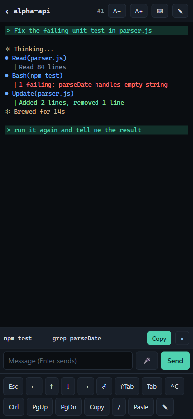

# claude-web (`cw`)



## Documentation

- [INSTALL.md](INSTALL.md): step-by-step install on Windows 11, including Tailscale, ntfy and autostart.
- [docs/HOWTO.md](docs/HOWTO.md): task-oriented usage guide and quick troubleshooting.

The screenshots in these documents are mock-ups with synthetic data.

## What it is

Run `cw` in a project folder. It starts Claude Code inside a small local **hub** and shows that session right in your terminal, just like running `claude` (or in your browser with `cw --web`). The same session can be reached from any device on your tailnet, so your phone can:

- list sessions and attach to them
- type into them, including approving permission prompts (there is a key bar and a compose box)
- start, kill and resume sessions

It also gets a push notification (through [ntfy](https://ntfy.sh)) when Claude needs input or has finished, on two separate topics so each can have its own sound.

- **The hub** is one Node process on `127.0.0.1:4242` (loopback only). It owns every session through a pseudo-terminal (node-pty/ConPTY) and serves a small web UI (xterm.js).
- **Access** requires a token, or, once you enable it, your Tailscale login (the Google account the tailnet is signed in with) when you come in through `tailscale serve`; see [Tailscale login](#tailscale-login-no-token-on-the-phone).
- **Remote access** goes only through `tailscale serve`, which provides HTTPS on your tailnet name. Tailscale Funnel (public internet) is never used.

Windows 11 and Node 22 or later are required (tested with Node 24).

## Install

```
git clone https://github.com/ilakskill/claude-web.git
cd claude-web
npm install
npm link            # puts `cw` on PATH
cw --version        # cw 0.1.0
```

Check which copy is active with `where cw`. Remove it with `npm unlink -g claude-web`.

The first run creates the data dir **`~/.cw`** (`%USERPROFILE%\.cw`, for example `C:\Users\<you>\.cw`). `CW_DATA_DIR` overrides it. It contains:

| File | Contents |
|---|---|
| `config.json` | Settings you changed, plus the random ntfy topic (see [Configuration](#configuration)). |
| `tokens.json` | Login tokens. The first one is named `default`. |
| `sessions.json` | Recent sessions (with their titles and how they ended), plus a snapshot of the running ones (so they show up under recent after a crash). |
| `hub.log` | Hub log. |
| `audit.log` | Audit trail. |
| `hub.pid`, `hub.port` | Written while the hub is running. |
| `hub-start.vbs` | Written by `cw hub install` (the logon task runs it). |
| `MIGRATED-FROM.txt` | Only if the dir was migrated (below). |

### Configuration

`~/.cw/config.json` holds only the generated `ntfyTopic` and the keys you set yourself. Every other setting comes from the built-in defaults, merged when the file is read, so a default changed by a later version reaches your install. Effective defaults:

| Key | Default | Meaning |
|---|---|---|
| `port` | `4242` | Hub port on `127.0.0.1` (`CW_PORT` overrides it) |
| `projectRoots` | `["C:\\Dev"]` | Folders whose subfolders the picker lists |
| `ntfyServer` | `"https://ntfy.sh"` | ntfy server for push notifications |
| `ntfyTopic` | generated `cw-<32 hex>` on first run | Your private topic for **needs input** pushes; written to the file |
| `ntfyTopicDone` | `<ntfyTopic>-done` | Topic for **finished** pushes, so the ntfy app can give it a different sound (see [Notifications](#notifications)). Derived when the file is read, never written; set it to the same value as `ntfyTopic` to get everything on one topic again |
| `notifyIdle` | `false` | Also push "waiting for input" idle reminders (on the needs-input topic, low priority) |
| `notifyPreview` | `false` | Put the start of Claude's last message (140 characters, markdown stripped) in the body of the **finished** push, so the lock screen says what was done. Off by default because that text is part of the transcript and leaves the PC through the ntfy server; see [Notifications](#notifications). Only a JSON `true` turns it on |
| `browser` | `"default"` | What `cw --web` opens (`"default"` or `"edge-app"`) |
| `localView` | `"terminal"` | Where `cw`, `cw attach` and `cw resume` show the session: `"terminal"` (attach in this terminal) or `"browser"` (the old behaviour, same as always passing `--web`) |
| `stripEnv` | `CLAUDECODE`, `CLAUDE_CODE_OAUTH_TOKEN`, `CLAUDE_CODE_SSE_PORT`, `CLAUDE_CODE_ENTRYPOINT`, `CLAUDE_CODE_CHILD_SESSION` | Variables removed from session environments (`NAME_*` is a prefix match). A value you set replaces the whole list; it must be an array (anything else falls back to the default with a WARN in `hub.log`). |
| `publicBase` | none | Base URL for links and the Host allowlist; see [Tailscale](#tailscale) |
| `claudePath` | `claude.exe` on PATH | Command of the `claude` preset (`CW_CLAUDE_PATH` overrides it); same as `harnesses.claude.path` |
| `defaultHarness` | `"claude"` | Preset started by `cw` with no `--harness`, and preselected in the web picker. Must be a known, non-hidden preset id, else `"claude"` with a `WARN config.defaultHarness` line |
| `notifyBell` | `"auto"` | Push when a session's program rings the terminal bell or sends an OSC 9/777/99 notification: `"auto"` (only harnesses without a hook channel), `true` (all harnesses), `false` (none). Anything else is `"auto"` with a WARN. See [Notifications](#notifications) |
| `terminalTint` | `true` | Color the text types inside session terminals per session (errors, your prompt, tool calls, turn status, ...); `false` keeps the single fixed palette. A non-boolean is `true` with a WARN. See [Terminal tint](#terminal-tint-colors-by-text-type). Reload the session page after changing it |
| `harnesses.<id>` | none | Per-preset overrides, `<id>` one of the [preset ids](#harnesses): `path` (existing file used instead of the command on PATH), `args` (string array replacing the preset's own arguments), `models` (string array replacing the model list), `hidden` (`true` leaves it out of the picker), `bell` (`false` turns off bell pushes for it). Bad keys or values are dropped with a `WARN config.harnesses.<id>.<key>` line. Restart the hub after editing |
| `voice` | `{"enabled": true, "engine": "whisper", "model": "small", "language": "auto", "device": "auto", "python": "C:\\Python314\\python.exe", "idleMinutes": 10, "requestTimeoutSeconds": 60, "talk": true, "ttsEngine": "kokoro", "ttsFallback": "piper", "ttsVoice": "af_heart", "ttsSpeed": 1, "ttsMaxChars": 600, "ttsThreads": 8, "ttsPython": "", "kokoroModel": "C:\\tools\\kokoro\\kokoro-v1.0.onnx", "kokoroVoices": "C:\\tools\\kokoro\\voices-v1.0.bin", "piperModel": "C:\\tools\\piper\\en_US-amy-medium.onnx"}` | Voice dictation on the session page ([Voice dictation](#voice-dictation)) and the `talk`/`tts*` keys of [Talk mode](#talk-mode). A nested object: set only the keys you change, the rest keep their defaults. A bad value falls back to its default with a `WARN config.voice.<key>` line in `hub.log`. |
| `tailscaleAuth` | `{"enabled": false, "allow": []}` | Sign in with the Tailscale identity instead of a token; see [Tailscale login](#tailscale-login-no-token-on-the-phone). `allow` is a list of lowercase Tailscale logins (account emails). Edit it with `cw auth tailscale …`, not by hand. A bad value is logged (`WARN config.tailscaleAuth.<key>`) and treated as disabled; `enabled: true` with an empty `allow` is disabled too. The hub re-reads this block when the file changes, so no restart is needed. |

Versions before this one wrote every default into `config.json` on first run, which froze them. The hub cleans that up by itself at startup: any key whose value equals such an old default (including the old 4-name `stripEnv` list without `CLAUDE_CODE_CHILD_SESSION`) is removed from the file once, and `hub.log` gets one `config cleanup: removed pinned default(s) …` line. Values you changed are kept. No manual edit is needed.

**Why not `%LOCALAPPDATA%`?** Versions before 2026-09-30 used `%LOCALAPPDATA%\cw`. The Claude desktop app is an MSIX package, and Windows gives every process it starts a private, virtualized copy of `%LOCALAPPDATA%`, so `cw` and the hooks run from there saw a different token and ntfy topic than the hub. The user profile is not virtualized. The first `cw` command after the upgrade copies `config.json`, `tokens.json` and `sessions.json` (not the logs, pid files or vbs) from `%LOCALAPPDATA%\cw` into a new `~/.cw`, once, and writes `MIGRATED-FROM.txt`. The token and the ntfy topic stay the same. The old folder is left alone; delete it when you like. Run that first command from Windows Terminal: inside the Claude desktop app it would copy the app's stale private copy instead. `cw hook` never migrates.

## Usage

| Command | What it does |
|---|---|
| `cw [--web\|--no-web] [--harness <id>] [claude args or prompt...]` | Starts the hub if needed, starts `claude` (or the `defaultHarness` / `--harness` preset, see [Harnesses](#harnesses)) in the current folder and attaches to it **in this terminal** (see [Terminal client](#terminal-client)). Examples: `cw`, `cw "fix the tests"`, `cw -p hi`. `--web` opens the browser instead and prints the local URL and the tailnet URL; `--no-web` forces the terminal. Both are cw's own flags, taken anywhere among the leading flags (before `--` or claude's first non-flag argument, e.g. `cw --resume --web`); claude never sees them. Without a terminal (piped, or a tool runner) `cw` falls back to the browser. |
| `cw [--web\|--no-web] -- <cmd> [args...]` | Same, but runs any command instead of claude, for example `cw -- pwsh -NoLogo`. |
| `cw ls [--all]` | Lists running sessions and recent ones with their [titles](#session-titles-and-the-recent-list); the label in brackets is the harness (`PowerShell`, `Codex`, ...), or the command name for older entries without one. `!` marks a session waiting for input; RESULT says how a recent session ended (`exit 0`, `killed`, `hub restarted`, `failed to start`). Titles are cut to the terminal width. Recent sessions without a Claude transcript are hidden unless renamed; `--all` shows them. |
| `cw clear [--all]` | Forgets recent sessions without a Claude transcript (shells, test sessions), unless renamed; `--all` forgets every recent session. Running sessions are never touched. |
| `cw attach [--web\|--no-web] <n\|id>` | Attaches to a running session in this terminal; `--web` opens it in the browser (also the fallback without a terminal). |
| `cw kill <n\|id>` | Ends a running session: Ctrl+C, then a hard kill after 3 s. An attached terminal client exits with `[cw] session #n exited (code …)`. |
| `cw rename <n\|id> <title...>` | Gives a session a custom name, shown instead of Claude's title (see [Renaming](#session-titles-and-the-recent-list)). `cw rename <n\|id> --clear` removes it. Works on running and recent sessions: `<n>` is looked up among running sessions first, then recent ones, so use the 8-character id for a recent entry. Prints `cw: renamed session #n <id> to "..."` or `cw: cleared the name of session #n <id>`; an unknown target gives `no session <t> (see: cw ls)` and exit code 1. |
| `cw resume [--web\|--no-web] <n\|id>` | Starts `claude --resume <id>` for a recent session and attaches to it (in the browser with `--web`). Needs the hooks, which record Claude's session id. For a recent session of another harness it uses that harness's own continue/resume form (see [Harnesses](#harnesses)). |
| `cw copy [--label <text>] [--session <n\|id>] [<text...>]` | Puts exact text in the session's [snippet tray](#snippet-tray-one-tap-copy-on-the-phone), where the phone copies it with one tap. The text is the arguments joined by spaces, else stdin. Meant to be run by the agent inside a cw session; `--session` picks another one. |
| `cw url [--qr]` | Prints the login URLs and the two ntfy topics (`ntfy needs-input: …` and `ntfy finished: …`). `--qr` also prints three QR codes: the login URL, then one per topic, labelled "ntfy needs-input topic (open in the ntfy app)" and "ntfy finished topic (open in the ntfy app)". |
| `cw notify test` | Asks the hub to send "cw test notification" to your needs-input ntfy topic. |
| `cw hub status\|start\|stop [--force]\|install\|uninstall` | Manages the hub process and the logon task. |
| `cw token add <name> \| ls \| rm <name>` | Manages login tokens. |
| `cw auth tailscale add <login> \| remove <login> \| list \| enable \| disable` | Lets a Tailscale login (your account email, e.g. `name@gmail.com`) open the hub from the tailnet without a token; see [Tailscale login](#tailscale-login-no-token-on-the-phone). `enable` refuses while the list is empty. `remove` and `disable` also close that login's open connections on a running hub. |
| `cw hooks install\|uninstall [--harness claude\|gemini\|codex]` | Adds or removes the notification hooks. Default `claude`: `Notification`, `Stop`, `PreToolUse[AskUserQuestion]` in `~/.claude/settings.json`. `gemini` and `codex` edit those tools' own files; see [Hooks for Gemini and Codex](#hooks-for-gemini-and-codex). |

Sessions end when the hub stops. To continue one, use `cw resume` or the Resume button in the web UI.

`ls`, `clear`, `rename` and `copy` are cw subcommands, so `cw ls` / `cw clear` / `cw rename` / `cw copy` never start claude with that word as a prompt; use `cw -- claude clear` for that.

### Session titles and the recent list

- **Titles** come from Claude's own transcript (`~/.claude/projects/<folder>/<claude session id>.jsonl`): the name you gave with `/rename`, else Claude's generated title, else an older-style summary, else your first prompt (cut to 80 characters). Hovering a title on the list page shows the first prompt. The hub needs Claude's session id, which the [hooks](#notifications) report after Claude's first answer, so a new session shows its folder name and "no title yet" until then. Titles of running sessions are refreshed every 30 s and on every hook; a recent session's title is refreshed when it ends and whenever the list is loaded. Transcripts are read in chunks of at most 512 KB and only the new part is read again.
- **Each row** shows the title (or the folder name), the command when it is not claude (for example `pwsh`), the folder, how long it ran, how it ended and when (`exit 0`, `killed` via Kill / `cw kill` / `cw hub stop --force`, `hub restarted` when it was running while the hub died, `failed to start`), and the last terminal activity.
- **Hidden entries.** Recent sessions without a Claude transcript (shells, test sessions, sessions that failed to start, Claude sessions that never reported an id) are hidden by default, unless renamed. The Recent header says `N hidden`; **Show all** shows them (remembered per browser). `cw ls` hides the same entries (same rule, `src/shared/recent-filter.js`); `cw ls --all` shows them.
- **Renaming.** A custom name wins over the transcript title everywhere: the list, the session tab and the `cw ls` TITLE column. Three ways to set it:
  - List page: every running and recent row has a **Rename** button that opens an inline input. Enter or **Save** saves, Esc or **Cancel** cancels. The editor survives list refreshes. A custom name shows in the accent colour, and Claude's own title moves to the tooltip.
  - Session page: tap the title in the top bar (or focus it and press Enter), type, then Enter (or the keyboard's Done) or **✓** to save, Esc or tapping elsewhere to cancel. The browser tab title follows. Saving an unchanged title does nothing, so Claude's title is never frozen into a custom name.
  - CLI: `cw rename <n|id> <title...>`; `cw rename <n|id> --clear` removes the name (an explicit empty `""` also clears, but Windows PowerShell 5.1 drops empty arguments, so use `--clear`). If a running session and a recent one share the number `<n>`, the running one wins; use the 8-character id for the recent one.

  Names are at most 80 characters, with whitespace collapsed and control characters removed. A name is kept when the session ends and copied to the session that Resume starts. A named session without a transcript (for example a shell) is not hidden and survives `cw clear`; only `cw clear --all`, **Clear recent** or the row's `×` removes it.
- **Cleaning up.** `×` on a recent row removes that entry (click again on "Delete?" to confirm), **Clear recent** removes all recent entries (confirm), `cw clear` removes the hidden ones and `cw clear --all` all of them. This only edits the list in `sessions.json`; Claude's transcripts are never touched, and a removed Claude session can still be resumed with `claude --resume`.
- **API.** `GET /api/sessions` and `/ws/list` entries carry `title`, `firstPrompt`, `hasTranscript`, `lastActivity`, `durationMs`, `userTitle` (the custom name, a string or `null`; `title` stays Claude's transcript title, and clients show `userTitle || title`) and (recent) `endReason`. `PATCH /api/sessions/<id|n>` (`<n>`: running or just-exited sessions only; use the id for recent entries) with JSON `{"title": "..."}` sets the custom name (an empty string or `null` clears it) and answers `{id, index, userTitle, title}`, where `title` is the display title; 400 for a bad body, 404 for an unknown session; it follows the same host, Origin and token rules as the other mutating routes and is audited as `rename`. `DELETE /api/recent/<id>` removes one recent entry (404 if unknown); `DELETE /api/recent` clears recent (`?hidden=1`: only entries without a transcript and without a custom name) and answers `{ok, removed, remaining}`.

### Copying terminal text on the phone

xterm.js has no touch selection, and a finger drag on the terminal scrolls it, so text is copied through a copy overlay instead. Open it with **Copy** in the key bar (after PgDn) or by **long-pressing the terminal** for about half a second without moving (a drag still scrolls and never opens it). The overlay is a full-screen read-only text box with the terminal's text: the whole history in a shell (newest 5000 lines, wrapped rows joined back into one line, trailing spaces removed), or the visible screen in Claude's fullscreen mode. Select with the phone's own handles and tap **Copy selection**, or tap **Copy all**; "Copied …" or an error shows next to the title for 1.5 s. **Close**, `×` or Esc returns to the terminal without raising the keyboard. The same button works with a mouse; mouse selection inside the terminal itself is unchanged. The clipboard needs a secure page: the `https://…ts.net:4242` URL and `http://127.0.0.1` qualify, a plain `http://<ip>` does not (the overlay then falls back to the browser's copy command, which may be refused).

### Snippet tray: one-tap copy on the phone

Agent CLIs hard-wrap long lines, so a command copied out of the terminal comes out as several lines (the copy overlay can only rejoin rows that xterm itself wrapped). Instead, the agent pushes the exact text to the hub and the session page shows it as a chip just above the key bar with a **Copy** button.

- **From the agent:** `cw copy [--label <short>] <text...>`, or pipe it in (`... | cw copy`, without the trailing line breaks, so a paste does not run the command by itself). The hub puts `CW_SESSION_ID` and `CW_HUB_PORT` in every session's environment, so the snippet goes to the session the agent runs in, on the hub that started it. `--session <n|id>` targets another running session (for example from a terminal outside cw). Flags go before the text; put `--` before text that starts with `-`. Outside a session without `--session` it prints `cw: not inside a cw session (CW_SESSION_ID is not set); pass --session <n|id> (see: cw ls)` and exits 1, as it does for an unknown session, empty text, or a hub that is down.
- **Suggested agent instruction** (for `CLAUDE.md`, `AGENTS.md` or `GEMINI.md`):
  ```
  When you give the user a command or code to run, also run `cw copy --label <short> '<exact text>'`.
  ```
- **OSC 52.** A program that writes the clipboard with OSC 52 (`ESC ] 52 ; <selection> ; <base64> BEL` or `... ESC \`) gets a snippet labelled `clipboard`. The query form (`?`), a clear (empty data), invalid base64 and text that is not UTF-8 are ignored. The bytes still reach every attached client unchanged, so a desktop terminal attached with `cw attach` sets its own clipboard as before.
- **The tray.** Hidden, taking no space, until the first snippet. One or two snippets show as chips (the label, else the start of the first line; the full text is the chip's tooltip). More than two collapse to the newest chip plus an **N snippets** pill that opens the whole list above the tray (floating, so the terminal is not resized); Esc or a tap elsewhere closes it. **Copy** writes the exact text with the same clipboard helper as the copy overlay (it needs the `https://…ts.net:4242` URL or `http://127.0.0.1`) and says **Copied** for 1.5 s. **×** hides the tray until a newer snippet arrives. New snippets are announced to screen readers.
- **Limits.** At most 64 KB of UTF-8 text per snippet, and the newest 10 per session, in memory only: they are gone when the session ends or the hub restarts. The text is never written to `hub.log` or `audit.log` (`audit.log` gets one `snippet` line per `cw copy`).
- **API.** `POST /api/sessions/<id|n>/snippets` with JSON `{"text": "...", "label": "..."}` (`label` optional; control characters removed, at most 40 characters) answers 201 `{id, sessionId, index, label, at, bytes}`; 400 for a bad body, 404 when no such session is running, 413 for text over 64 KB. It follows the same Host, Origin and token rules as the other mutating routes. On `/ws/session/<id>`, attached clients get `{"t":"snippet", id, label, text, at, source}` (`source` is `api` or `osc52`), and a client that attaches gets `{"t":"snippets", "snippets": [...]}` (oldest first) right after `init` when the session has any.

### Terminal tint: colors by text type

Inside a session the terminal text is colored by type, and the session's accent color (the one on the list and title bar) drives the highlights: your own prompt row gets a dark accent tint with accent-colored text, and the cursor and selection follow the accent. Fixed colors: errors red, warnings amber, a permission/"needs you" prompt strong amber, diffs red/green, assistant text light, tool calls blue, tool output slate, the turn-status line (`✻ Brewed for 5s`) tan, and a cross-session message (`› Message from @...`) mint. All text meets WCAG AA (4.5:1) on the terminal background.

**One step for you:** in Claude Code run `/theme` and pick **Dark mode (ANSI colors only)**. The default and the colorblind/daltonized themes use truecolor (RGB) codes, which a terminal palette cannot recolor, so they keep Claude's own colors (the tint still paints the line types it recognizes by their leading glyph). Codex mostly uses named ANSI colors already and needs no setting.

How it works: the page remaps xterm's 16-color palette per session, and for the types that Claude draws in the same slot (turn status, cross-session message and tool output are all "dim") it paints xterm decorations over the rendered rows. It only reads the screen; the PTY stream is never rewritten. Turn it off with `"terminalTint": false` in `~/.cw/config.json` and reload the page.

### Key bar

On a phone the key bar (Esc, arrows, Tab, Ctrl, PgUp/PgDn, Copy, Paste, …) and the title bar (back link, session name, font and ⌨ / ✎ buttons) get out of the way by themselves: about 4 s after the last tap on the key bar, or as soon as a finger starts scrolling the terminal, both collapse behind a thin handle with a chevron at the top of the screen (under the browser's address bar) and the terminal grows by their height (about seven rows at the default font). They stay while the on-screen keyboard is open or the compose, paste or rename box has focus. To bring them back: tap or swipe the handle, or tap the terminal with two fingers. A long-press on the handle, or the ⌨ button in the title bar, cycles the preference and shows it for a moment: **auto** (the default on phones), **always** (both bars never collapse) or **hidden** (handle only; a tap on it shows both for 4 s). The choice is kept per browser (`localStorage` key `cw.keybar`). To keep just the title bar, tap **📌** in it: pinned (the pin lights up, "Top bar pinned" shows for a moment) the title bar stays in every mode while the key bar still collapses, its handle then sitting right under the title bar and bringing back the key bar only; tap again to unpin. The pin only shows on phones (where the "n clients" count leaves the title bar to make room for it) and is kept per browser too (`cw.topbarPin`). A phone is any browser with a coarse pointer, no hover, a touch screen without a mouse, or a window under 768 px; the browser console prints one `keybar: phone=… (reason)` line at load, and `cw.keybarAutohide.state` shows the same. At a desk nothing changed: ⌨ turns the key bar on and off and the title bar stays. The collapse animates over 150 ms unless the device asks for reduced motion.

### Split view (desk)

Up to four live sessions in one browser tab. On the list page, **Split view** (next to "Running"; hidden on phones and narrow windows) turns each running row's number into a checkbox; tick up to four and press **Open split (n)**. The page is `/split?s=<id>,<id>,…`, so it can be bookmarked and reloaded; invalid and duplicate ids are dropped. Two sessions sit side by side, three or four make a 2x2 grid (with three, the free cell lists the other running sessions), one fills the page; **+ add session…** at the top adds more. Each pane is the normal session page framed in embed mode (`/s/<id>?embed=1`), so input, resize, copy, the snippet tray, compose, dictation and file drop all work inside it. The pane header shows the name, `#n` and a needs-input dot and badge; **A− / A+** change that pane's font, **↗** opens the session in its own tab, **×** closes the pane (the session keeps running). To rename a session, double-click its pane title or press **✎** next to it: the title becomes a text box (typing goes there, not to the terminal); Enter or **✓** saves with the same rules as the list page (trimmed, up to 80 characters, empty clears your name), Esc or clicking elsewhere cancels, and the terminal gets the keyboard back. A rename made anywhere else (list page, phone, `cw rename`) shows in the pane header right away. Click a pane's header, or into its terminal, to type there; the focused pane has an accent border. In a pane the session's own title bar is hidden and a narrow pane does not count as a phone (no key bar auto-hide). If a pane's session ended, its overlay offers Resume as usual and the split keeps the new session in place.

Pane sizes: drag the divider between the columns (2-4 panes) or between the rows (3-4 panes) to resize; the two dividers cross the whole grid, so in a 2x2 both panes of a column share its width and both panes of a row share its height. A divider is a thin line in the gap with a short grip, lit on hover; double-click it for equal sizes. With the keyboard, Tab to a divider (it is a focusable `separator`) and use Left/Right (columns) or Up/Down (rows), 2% a press, 10% with Shift, Home/End for the smallest/largest. No pane gets less than 15% of the span or 120 px. The split is kept in the URL as the left column and top row in percent (`/split?s=<id>,<id>&w=62&h=40`, left out at 50), so a reload or bookmark keeps it; closing or adding a pane keeps the column split, and the row split is kept while the grid stays 2x2 (it starts even again after going down to two panes). While a divider is dragged the panes do not refit; on release each terminal refits once and, if it owns its session's size, sends one resize to the hub.

Size: every pane is an ordinary web client of its session, under the same rule as tabs (the most recently active client owns the PTY size). Opening or reloading the split attaches each pane with its fitted size, so it takes the size of each of its sessions, exactly like opening each one in a tab. After that, resizing or re-laying out panes never takes the size from another device: a pane only reports its size while it owns it. A phone that types takes the size back (the pane then renders at the phone's size and shows "another device owns the size"); typing in the pane takes it again. Panes of different sessions never interact, and one session can appear only once per split.

### Dropping or pasting files into a session

Drag a file (or several) from Explorer onto a session page, or press Ctrl+V in the terminal with an image (a screenshot) on the clipboard: the file is uploaded to the hub, saved under `%TEMP%\cw-uploads\<session id>\<random>-<name>` (outside any repo), and its absolute path is typed into the terminal, double-quoted when it contains spaces or shell characters, several paths separated by spaces, without Enter, so Claude Code or Codex can read it, as when dragging a file into a native terminal. The path goes in through the terminal's normal paste, so it is a bracketed paste when the program asked for one (Claude Code then shows a pasted image as an attachment). A dashed outline shows while a file is over the page and a small status line shows the progress and the result. Text paste is unchanged: Ctrl+V with text on the clipboard pastes the text, and the compose bar and the paste box never upload. In the split view, drop onto a pane's terminal or its header.

- **Names.** Only the last path segment is kept; control characters are removed, `<>:"|?*` and whitespace become `_`, leading dots and trailing dots or spaces go, Windows device names (`CON`, `NUL.txt`, `COM1`, …) get a `_` prefix, and at most 100 characters remain, extension kept. A clipboard image is named `pasted-<yyyymmdd-hhmmss>.<ext>`.
- **Limits.** 25 MB per file (the page refuses larger files before sending; the hub answers 413). Uploaded files are not deleted by cw; Windows' temp cleanup (Storage Sense) or you remove them.
- **API.** `POST /api/sessions/<id|n>/upload?name=<file name>` with the raw file as the body answers 201 `{path, name, bytes, sessionId}`; 400 for an empty body, 404 when no such session is running, 413 over 25 MB. Same Host, Origin and token rules as the other mutating routes; audited as `upload`. The file name is never written to `hub.log` or `audit.log`.

### Focus view (Codex sessions)

Codex's terminal fills up with `• Ran <command>` cells, output previews and hook messages. On a Codex session the title bar (and a split pane's header) has a **Focus** button that lays a chat-style view over the terminal: your prompts, Codex's answers (a safe markdown subset: paragraphs, lists, code, bold, http(s) links; never HTML) and plans, with every run of tool calls and Codex's progress notes collapsed into one line such as `Ran 3 commands, edited 2 files · 1 failed`. Tap the line to see each call, tap a call to see its output or diff. The view follows new activity (it stays where you are if you scrolled up) and shows "Codex is working…" during a turn.

- **Typing.** The terminal keeps running underneath at its size. Focus opens the compose bar (without changing its remembered setting); the key bar, dictation and file drop work as usual.
- **Waiting for you.** The bar at the bottom turns amber with **Open terminal** when Codex shows an approval prompt (the hub looks for Codex's approval wording in the bottom rows of the terminal) or the session needs input; after a finished turn it says `Codex finished · reply below` (or that Codex asked something).
- **Remembered** per session in the browser (`localStorage` key `cw.focus.<id>`); **Focus** again or **Open terminal** goes back.
- **Where it comes from.** Codex writes every thread to `~/.codex/sessions/YYYY/MM/DD/rollout-<time>-<thread id>.jsonl` (`CW_CODEX_HOME` moves it). The hub reads that file incrementally and read-only, and only ever opens files under that `sessions` folder. It picks the file by the thread id when it knows one (the Codex hook's session id, or `codex resume <id>`), else the Codex CLI thread in the session's folder written most recently since the session started, so `/new` and resumed threads are followed within about 3 s; `resume --last` shows the folder's newest thread right away. Subagent, Codex desktop app and `codex exec` threads are ignored, and a file shown for another running session is never picked.
- **Limits.** Codex creates the file with the first prompt, so a new session shows "No Codex conversation yet" until then. A command shows up when it finishes (Codex records nothing while it runs). If another Codex outside cw works in the same folder at the same time and the hooks have not reported the thread id yet, the view can show that one. A thread resumed from the in-app picker (`/resume`) whose file is more than 14 days old is found only once the Codex `Stop` hook reports its id. The first answer carries the newest 250 events; tool output is cut to 1500 characters.
- **API.** `GET /api/sessions/<id|n>/focus?since=<seq>&thread=<id>` answers `{available, thread:{id, cwd, startedAt, file}, reset, seq, truncated, events, turn, waiting}`; `events` are those after `since` (all of the newest 250 with `reset: true` when `thread` is not the current one). `turn` is `running`, `idle`, `ended` or null; `waiting` is null or `{kind: 'approval', text}`, `{kind: 'needs-input'}`, `{kind: 'your-turn', question}`. 400 for a session that is not Codex, 404 for an unknown one. Same auth as every route; not logged or audited (the page polls it every 1.5-3 s while the view is open and visible).

## Harnesses

A **harness** is a preset for one agent CLI. The web **New session** form has a harness picker (and a model picker for the harness) in front of the Command field; the list rows show the harness as a badge, and **Continue** / **Resume** buttons use that harness's own arguments. From the terminal use `cw --harness <id> [args...]`, for example `cw --harness codex` or `cw --harness gemini -m gemini-2.5-pro`. `--harness` is cw's own flag (taken among the leading flags like `--web`); an unknown id is refused. `POST /api/sessions` takes `harness` and `model` too. Without either, the `defaultHarness` runs.

| Id | Command | Continue | Resume by id | Model list from | Hook push | Bell push (`auto`) |
|---|---|---|---|---|---|---|
| `claude` | `claude` | `--continue` | `--resume <id>` | built in: sonnet, opus, haiku | yes | no |
| `agy` | `agy` | `--continue` | `--conversation <id>` | `agy models` | no | yes |
| `copilot` | `copilot` | `--continue` | `--resume <id>` | `copilot help config` | no | yes |
| `gemini` | `gemini` | `--resume latest` | not supported | none (type a model name) | yes | no |
| `codex` | `codex` | `resume --last` | `resume <id>` | `~/.codex/config.toml` | yes | no |
| `opencode` | `opencode` | `--continue` | `--session <id>` | `opencode models`, else `~/.config/opencode/opencode.json` | no | yes |
| `hermes` | `hermes` | `--continue` | `--resume <id>` | `~/.hermes/config.yaml` | no | yes |
| `pi` | `pi` | `--continue` | `--session <id>` | `pi --list-models` | no | yes |
| `ollama` | `ollama run <model>` (a model is required) | no | no | `http://127.0.0.1:11434/api/tags`, else `ollama list` | no | yes |
| `shell` | `pwsh -NoLogo` (label PowerShell) | no | no | no model | no | yes |

- **Custom model.** The model picker has a "custom" entry that reveals a text box, so a model missing from the list can still be used. A model name is at most 100 characters with no control characters.
- **Overrides.** `harnesses.<id>.path` points at a different executable, `.args` replaces the preset's arguments, `.models` replaces the list, `.hidden` removes the preset from the picker, `.bell` set to `false` silences its bell pushes (see [Configuration](#configuration)). Example: `"harnesses": {"hermes": {"args": ["chat"]}, "ollama": {"hidden": true}}`. The form shows a preset's arguments but cannot remove them; use `harnesses.<id>.args` for that.
- **Environment.** `CW_GEMINI_HOME` (default `~/.gemini`) and `CW_CODEX_HOME` (default `~/.codex`) move the folders `cw hooks install --harness gemini|codex` writes to, like `CW_CLAUDE_HOME` does for Claude.
- **npm `.cmd` shims.** Most of these CLIs are installed by npm as a `.cmd` shim. The hub reads the shim, finds the script it runs and starts `node <script>` itself, so no `cmd.exe` sits between cw and the program (Ctrl+C and kill reach it directly). `hub.log` records `launch <id>: <command> via exe|node-shim|cmd`. If a shim cannot be parsed, the hub falls back to `cmd.exe /d /s /c`, which is best effort for paths with spaces.

### Hooks for Gemini and Codex

`cw hooks install --harness gemini` and `--harness codex` add the same `cw hook` command as the Claude install, with the same backup, formatting and idempotence rules (see [Notifications](#notifications)); `cw hooks uninstall --harness <id>` removes only the cw entries.

| Harness | File edited | Events added | Timeout |
|---|---|---|---|
| `gemini` | `~/.gemini/settings.json` (`CW_GEMINI_HOME`) | `Notification` (needs input), `AfterAgent` (finished) | 5000 ms |
| `codex` | `~/.codex/hooks.json` (`CW_CODEX_HOME`; created if missing) | `Stop` (finished) | 5 s |

The backup is `<file>.bak-YYYYMMDD-HHMMSS` next to the file. A malformed file is refused and left untouched. The hub matches a hook to its cw session by cw's session id when the payload carries it, else to the newest running session in the same folder, so pushes carry the session number and the same tap link. The payload fields cw reads (`hook_event_name`, `session_id`, `cwd`, `message`, `notification_type`) come from the tools' documentation; they were not captured from the real tools, so check the first real push after installing.

## Voice dictation

The session page's compose bar has a microphone button. **Hold it to talk** on a phone (release to transcribe); **click** it to start and click again to stop with a mouse. The text is appended to the compose box, where you can fix it before tapping **Send**. Nothing is typed into the terminal until you send.

- **Where the audio goes.** With the default engine (`"whisper"`) the page streams raw audio over the same tailnet connection as the terminal, and the hub transcribes it on this PC with [faster-whisper](https://github.com/SYSTRAN/faster-whisper) (`src/hub/stt-sidecar.py`, a Python process the hub starts when it starts (`prewarm`) and stops after `idleMinutes`, 120 by default, without a request). Audio is never written to disk, and neither audio nor text is logged; `audit.log` gets one `voice` line per utterance. With `"engine": "browser"` the page uses the browser's own speech recognition instead; on Android Chrome that sends the audio to Google, so it is off by default.
- **What it needs.** `voice.python` must be an interpreter with `faster-whisper` installed (`pip install faster-whisper`; on this PC it is in the user site-packages of `C:\Python314`, so the hub runs the interpreter with `-P` only, not `-I`/`-s`, which would hide that folder). An NVIDIA GPU with CUDA is used when `device` is `"auto"` or `"cuda"` (float16); otherwise the CPU (int8). The first use of a model downloads it once from Hugging Face into `%USERPROFILE%\.cache\huggingface\hub` (`small` is about 460 MB, `base` 140 MB); the hub allows 3 minutes for that first start. The page needs a secure context for the microphone: the tailnet `https://` URL or `http://127.0.0.1`.
- **Settings** (`voice` in `config.json`): `model` (`tiny`, `base`, `small`, `medium`, `large-v3`, the English-only `*.en` variants, or a local CTranslate2 model folder), `language` (`"auto"` or a code such as `"en"`, which is faster and avoids misdetection), `device`, `idleMinutes` (default 120; 0 keeps the process alive; also applies to Talk mode's synthesizer), `prewarm` (default `true`: the hub starts the transcriber and, with Talk on, the synthesizer in the background when it starts, so the first utterance of the day does not pay for the import and model load, which was 25 to 130 s here; `false` starts them on first use), `enabled: false` hides the button and refuses `/ws/voice`. Changes need a hub restart. Measured on this PC (RTX 3060 Ti, `small`, CUDA): about 0.3 s for a 5 s utterance and 0.9 s for 26 s, plus, when the process is not running, 15 to 65 s (cold disk cache or a busy PC) while it imports and loads the model: `prewarm` and the long `idleMinutes` exist to keep that off the first utterance.
- **Limits.** One utterance is at most 120 s, and one transcription at a time per page (releasing again while "transcribing…" is shown gets a "still transcribing" message). A transcription that takes longer than `requestTimeoutSeconds` is abandoned with an error and the transcriber process is restarted. Dictation needs a running session page; it does not work on the list page. `GET /api/voice` reports the effective engine and model (never the interpreter path).

## Talk mode

Push-to-talk with spoken replies, for Claude and Codex sessions. On the session page press the **speaker button** in the title bar: a bar appears above the compose bar with a big **Hold to talk** button. Hold it, speak, release: the words are transcribed (the dictation engine above) and typed into the session with Enter, so Claude gets them straight away (the compose box is not used, and a short "Sent: ..." line shows what was heard). When Claude finishes a turn, the hub makes speech from its final message and the page plays it; **Stop** (or pressing Hold to talk) cuts it off. Nothing listens unless the button is held. The on/off choice is remembered per session in the browser; a split-view pane never starts Talk by itself.

- **Speed.** Four things keep Talk mode quick. (1) The transcriber and the synthesizer are started with the hub (`voice.prewarm`) and stay up for `voice.idleMinutes` (120 by default; they used to stop after 10 minutes, so most attempts were cold); a page that turns Talk on warms them again if they were stopped. (2) The synthesizer makes one part at a time, and the hub keeps the waiting parts itself: the first part of the newest reply goes first, and parts of a reply that a newer one has replaced are dropped before they cost any time (only the part already being made finishes). (3) Listening uses the browser's own speech recognition when it can, with the words showing live in the Talk bar, and the hub's whisper otherwise (see the privacy note below). (4) The page polls every 0.7 s instead of 1.5 s for five minutes after something is sent, since a reply is expected.
- **Who listens.** With `voice.talkBrowserStt` (default `true`) Talk mode uses the browser's SpeechRecognition (the Web Speech API) while it is on: the words appear as you speak and there is no model to wait for. **Privacy: Chrome sends that audio to Google's servers, Edge to Microsoft's.** Set `"talkBrowserStt": false` to keep all audio on this PC (the hub's whisper then listens), or flip the **Listen: browser / hub** switch under the Talk bar for one browser. It needs a secure context (the tailnet `https://` URL or `http://localhost`); on a plain-HTTP LAN address, in Firefox, when the hub says no, or when the browser's service fails (`network` error), the page uses the hub's whisper instead (the failure is shown once and the page stays on whisper until reloaded; that utterance is lost). Plain dictation in the compose bar keeps using whisper.
- **Typing and keyboard dictation.** The Talk bar has a text box with **Send**: whatever you type, or dictate with the phone keyboard's microphone key (Gboard, iOS) or Windows `Win+H`, goes to the session like a spoken utterance. It works when neither microphone path does (plain-HTTP pages).
- **Who speaks.** By default the hub's Kokoro voice. The **Voice: hub / browser** switch uses the browser's own `speechSynthesis` voice instead: it starts at once with no synthesis wait, sounds plainer, and some browsers send the text to their vendor. The hub prepares no audio for a page that chose it. (`ttsEngine: "browser"` makes it the choice for every page.)
- **What is spoken.** Only the final assistant message of the turn: the Stop hook's `last_assistant_message`, else the end of the transcript (`~/.claude/projects/<cwd>/<session>.jsonl`: the last text no tool call follows; commentary before tool calls, thinking and tool output are skipped). For Codex, the final answer of a finished turn in its rollout file (the same feed as the Focus view). Markdown is cleaned for the ear: code blocks become "Code block omitted.", tables "Table omitted.", links keep their text, bare URLs become "link", emoji and symbols are dropped. Only the first `ttsMaxChars` (600) characters are spoken, cut at a sentence end, then "The rest is on screen." It is cut into parts of about 120 then 220 characters; the first part starts playing while the rest are made.
- **Where it runs.** On this PC, nothing leaves it. `src/hub/tts-sidecar.py` (a Python process, started with the hub or, if stopped, when a Talk page is open, and stopped after `idleMinutes`) runs [Kokoro](https://github.com/thewh1teagle/kokoro-onnx) through `onnxruntime`, with [Piper](https://github.com/OHF-Voice/piper1-gpl) as the fallback if Kokoro cannot start or fails (a Kokoro that cannot start is not retried for 5 minutes). Audio is made only when a page with Talk on asks for it (and the first parts of a reply are made at once while a Talk page is polling), as 16-bit mono WAV files in a private temp folder (`%TEMP%\cw-tts-*`; the path is in the `talk:` line of `hub.log`), swept after 20 minutes or beyond 60 files and removed when the hub stops. Neither the reply text nor the audio is logged; `audit.log` gets one `speak` line per spoken turn. The routes use the same token auth as every other route, and only files the cache itself made are served.
- **What it needs.** `voice.python` (or `ttsPython`) must have `kokoro-onnx`, `piper-tts`, `numpy` and `onnxruntime` installed (all present in the user site-packages of `C:\Python314` on this PC), plus the model files, which are not downloaded automatically: `kokoro-v1.0.onnx` and `voices-v1.0.bin` from the [kokoro-onnx releases](https://github.com/thewh1teagle/kokoro-onnx/releases) (here in `C:\tools\kokoro`), and a Piper voice such as `en_US-amy-medium.onnx` with its `.onnx.json` (here in `C:\tools\piper`). Set `kokoroModel`, `kokoroVoices` and `piperModel` if they live elsewhere. For Claude sessions the hub learns that a turn ended from the Stop hook, so the cw hooks must be installed (`cw hooks install`); without them nothing is spoken.
- **Settings** (`voice` in `config.json`; changes need a hub restart): `talk` (`false` hides the speaker button and refuses the routes), `talkBrowserStt` (see Who listens), `prewarm` and `idleMinutes` (see Speed), `ttsEngine` (`"kokoro"`, `"piper"`, or `"browser"`: the page speaks with the phone's own `speechSynthesis` voice, which may send text to the OS vendor; off by default), `ttsFallback` (`"piper"` or `"none"`), `ttsVoice` (a Kokoro voice such as `af_heart`, `af_bella`, `am_adam`, `bf_emma`; list them with `Kokoro.get_voices()`), `ttsSpeed` (0.5 to 2), `ttsMaxChars` (40 to 5000), `ttsThreads` (CPU threads for synthesis, default 8; the default of onnxruntime, one per logical CPU, was 2 to 3 times slower on this 32-thread PC; 0 restores it), `ttsPython`, `kokoroModel`, `kokoroVoices`, `piperModel`. `GET /api/voice` has a `talk` block (enabled, engine, availability, voice, limits; never paths).
- **Measured on this PC** (Kokoro, CPU with 8 threads, `af_heart`): about 0.3x real time, so the first part (about 110 characters, 7 s of speech) is ready 2.5 s after the turn ends, and a 300-character reply takes about 5.4 s to make in full; the process and model take about 2.5 s to load (when the Talk button is pressed, so the first reply does not wait for it). Piper was about 1.6 times faster here. Both run on the CPU: the installed `onnxruntime` has no GPU provider, and no CUDA 12 build of `onnxruntime-gpu` exists for Python 3.14 yet.
- **Phones.** Browsers only allow sound after a tap, so the page creates its audio context inside the tap on the speaker button; after a reload with Talk remembered as on, the first touch anywhere re-enables sound (the state line says "tap the page once to allow sound" if a reply arrives first). The screen is kept on while Talk is on (Wake Lock), because a locked phone throttles the page and replies would wait until it is unlocked. Replies play only while the page is open and visible. The microphone needs the tailnet `https://` URL, as for dictation.
- **Limits.** One reply plays at a time; a newer one replaces it. Two pages with Talk on for the same session both speak. A reply that is only code says "Code block omitted." `Notification` events (permission prompts) are not spoken.

## Terminal client

`cw` (and `cw attach`, `cw resume`) shows the hub session inside the terminal you ran it from, full screen, with the same keys as running `claude` directly. It prints one line first:

```
cw: session #3 1a2b3c4d · detach Ctrl+\ · browser http://127.0.0.1:4242/s/1a2b3c4d
```

- **Detach: `Ctrl+\`.** The session keeps running in the hub. The client restores the terminal (leaves the full-screen view, turns off the key/mouse/paste modes Claude turned on) and prints `[cw] detached from #3; reattach: cw attach 3`. Exit code 0.
- **Reattach** with `cw attach <n>`, from any terminal. The screen is restored exactly as the hub has it. The browser and the phone can be attached at the same time; the window size follows whichever client typed last.
- **Closing the terminal tab** only ends the client. The session keeps running (`cw ls`), and `cw attach <n>` picks it up again.
- **When the session ends** (Claude exits, or `cw kill <n>` from elsewhere), the client restores the terminal, prints `[cw] session #n exited (code …)` and exits with Claude's exit code.
- **Hub connection lost:** the client shows `[cw] connection lost, retrying…` and retries every second. It resyncs the screen when the hub answers; after 10 s it gives up with `[cw] hub unreachable; session may still be running: cw ls` (exit 2).
- **Browser instead:** `cw --web`, `cw attach --web <n>`, `cw resume --web <n>`, or set `"localView": "browser"` in `~/.cw/config.json` to make the browser the default again. `--no-web` forces the terminal even then.
- **Without a console** (the Claude desktop app's command tool, piped input, a script), `cw`, `cw attach` and `cw resume` print `cw: stdin/stdout is not a terminal; opening the session in the browser instead (--web)` and behave exactly like `--web`. They exit 3 only when no browser could be opened either (the URL is still printed), or with `--no-web` (before any session is created).
- Ctrl+C, Esc, Shift+Tab, Shift+Enter and the other keys go to Claude unchanged: the client forwards Windows Terminal's key records (win32-input-mode) as they are. Only `Ctrl+\` is taken by cw.
- Exit codes: 0 detached, Claude's code when the session exits, 1 client stopped by Ctrl+Break or a console close (the terminal is restored; the session keeps running), 2 hub unreachable, 3 no terminal and no browser (or `--no-web` without a terminal), 4 no such session.

## Phone setup

Tailscale DNS (MagicDNS) must be enabled in the phone's Tailscale app.

The phone must be on the same tailnet (Tailscale app signed in), and `tailscale serve` must be set up (see [Tailscale](#tailscale)). Do these in order:

1. **On the PC, open Windows Terminal** (not a terminal inside the Claude desktop app; see [below](#running-cw-from-inside-the-claude-desktop-app)) and run `cw url --qr`. It prints the login URL, the two ntfy topics, and three QR codes. They contain your token and your topics: do not paste them anywhere.
2. **Notifications.** Install the **ntfy** app on the phone and subscribe to **both** topics: scan the second QR code ("ntfy needs-input topic") and the third ("ntfy finished topic"), or add the topics printed as `ntfy needs-input: subscribe to cw-… on https://ntfy.sh` and `ntfy finished: subscribe to cw-…-done on https://ntfy.sh` by hand. Then run `cw notify test` on the PC; "cw test notification" should arrive on the needs-input topic within a few seconds. To give each topic its own sound, see [Sounds](#sounds).
3. **Log in once.** Scan the first QR code with the phone camera. It opens `https://<pc>.<tailnet>.ts.net:4242/?t=<token>`; the hub swaps the token for an HttpOnly cookie and redirects to the plain URL, so the token leaves the address bar. **Bookmark that page.** From then on, open the bookmark or tap a notification.

   **Without a token** (optional): enable [Tailscale login](#tailscale-login-no-token-on-the-phone) on the PC. Then any browser on a phone that is on the tailnet with your Tailscale account can open the plain `https://<pc>.<tailnet>.ts.net:4242/` directly; `cw url` prints it as `tailnet (no token):`. The page header shows `signed in as <login>`.

### Tailscale login (no token on the phone)

`tailscale serve` authenticates the device that connects and adds the tailnet user's identity to every request it proxies to the hub, as `Tailscale-User-Login` (for example `you@example.com`, the account the tailnet is signed in with). With this feature on, the hub treats an allow-listed login arriving that way as signed in, with no token and no cookie. Token login keeps working exactly as before.

```
cw auth tailscale add you@example.com   # allow this account
cw auth tailscale enable                           # turn it on (refused while the list is empty)
cw auth tailscale list                             # state and allowed logins
cw url                                             # prints "tailnet (no token): https://<pc>.<tailnet>.ts.net:4242/"
cw auth tailscale remove <login> | disable         # revoke; open connections of that login are closed at once
```

- No restart: a running hub re-reads `tailscaleAuth` from `config.json` whenever the file changes.
- Logins are compared lowercase; the header is checked on every request and every WebSocket upgrade, so a removed login is locked out immediately.
- `audit.log` records such requests as `ts:<login>` (second column) with the raw header in the third.
- `GET /api/me` answers `{"name":"ts:<login>","via":"tailscale","login":"<login>"}` for an identity login, `{"name":"<token name>","via":"cookie"}` for a token. The list page uses it for the `signed in as` text.

**When it is safe, and when not.** The hub only trusts the header when the TCP peer is loopback (`127.0.0.1`, `::1`), which is where `tailscale serve` connects from; Tailscale strips any `Tailscale-*` header a client sends before adding its own. A request with that header from any other address is refused, and the hub refuses to start with this enabled on a non-loopback bind (it never binds anything else anyway). What this cannot stop: a process on this PC can connect to `127.0.0.1:4242` itself and set the header. On a single-account PC that is the same trust level a process already has by reading `tokens.json`; on a PC with other Windows accounts, leave this off and use tokens. Never combine it with `tailscale funnel` (never use Funnel at all).

## Notifications

`cw hooks install` edits `%USERPROFILE%\.claude\settings.json`. `CW_CLAUDE_HOME` overrides the folder.

- **What it adds.** It adds one entry each to `hooks.Notification` and `hooks.Stop`:
  ```json
  { "hooks": [ { "type": "command", "command": "C:/nvm4w/nodejs/node.exe \"C:/path/to/claude-web/bin/cw.js\" hook", "timeout": 5 } ] }
  ```
  and one to `hooks.PreToolUse`, limited to the `AskUserQuestion` tool (the clarifying-question dialog Claude waits on):
  ```json
  { "matcher": "AskUserQuestion", "hooks": [ { "type": "command", "command": "C:/nvm4w/nodejs/node.exe \"C:/path/to/claude-web/bin/cw.js\" hook", "timeout": 5 } ] }
  ```
  The paths are those of your node and your checkout. Other `PreToolUse` groups you have (for example a `Bash` matcher) are left alone. The cw hook prints nothing and exits 0, which for a `PreToolUse` hook means "no decision": the tool always runs. An install from a version that only had the first two hooks adds just the `PreToolUse` entry.
- **Command form.** The node path is unquoted and uses forward slashes; a path with spaces is replaced by its 8.3 short name. The `cw.js` path is quoted. This exact string is verified under `cmd.exe /c`, `cmd.exe /d /s /c`, Git Bash `sh -c` and `pwsh -Command`, because Claude Code's choice of hook shell on Windows is not documented.
- **Backup.** It backs up the file first to `settings.json.bak-YYYYMMDD-HHMMSS` (`-1`, `-2` … if that name exists), prints the backup path, and never overwrites an older backup. A second install changes nothing. An old cw entry, for example one with a previous node path, is updated in place; a legacy flat `{type, command}` cw entry is rewritten as a proper group.
- **Formatting.** The file is rewritten as 2-space JSON:
  - A UTF-8 BOM, CRLF line endings and the final newline are kept.
  - Key order and every other setting are kept.
  - Install followed by uninstall gives back the original bytes of a 2-space-indented file (a file with other indentation comes back re-indented).
  - The backup holds the original bytes.
- **Malformed files.** A malformed `settings.json` is refused and left untouched.
- **Uninstall.** `cw hooks uninstall` removes only entries whose command contains `cw.js" hook`, after a backup. You can also restore a `.bak-*` file by hand.

`cw hook` (run by Claude) posts the event to the hub and always exits 0 within about 2 s, so it never blocks Claude. It only reads `~/.cw` (the token, and the port from `config.json`, else 4242); it never creates the folder or writes to it. The hub then sends:

| Event | Topic | Title | Priority / tag |
|---|---|---|---|
| permission prompt (`Notification`, `permission_prompt`) | `ntfyTopic` | `cw #3 needs input · <folder>` | high / `warning` |
| clarifying question (`PreToolUse`, tool `AskUserQuestion`) | `ntfyTopic` | `cw #3 needs input · <folder>`; the body is the first question | high / `warning` |
| elicitation dialog, agent needs input (`Notification`, `elicitation_dialog` / `agent_needs_input`) | `ntfyTopic` | `cw #3 needs input · <folder>` | high / `warning` |
| Claude finished its turn (`Stop`) | `ntfyTopicDone` | `cw #3 finished · <folder>`; with `notifyPreview`, the body is the start of Claude's last message | default / `white_check_mark` |
| idle reminder (`Notification`, `idle_prompt`; only with `notifyIdle`) | `ntfyTopic` | `cw #3 idle · <folder>` | low / `hourglass` |
| Claude desktop app, or a terminal not started by cw | same rules | `Claude needs input · <folder>`, `Claude finished · <folder>` | same |
| Gemini CLI `Notification` / `AfterAgent` hook (after `cw hooks install --harness gemini`) | `ntfyTopic` / `ntfyTopicDone` | `cw #3 needs input · <folder>` / `cw #3 finished · <folder>`; `Gemini ...` for a session cw did not start | same as Claude |
| Codex `Stop` hook (after `cw hooks install --harness codex`) | `ntfyTopicDone` | `cw #3 finished · <folder>`; `Claude finished · <folder>` when no cw session matches (see Limitations) | same as Claude |
| Terminal bell or OSC 9/777/99 from a session of a harness without hooks (or any harness with `notifyBell: true`) | `ntfyTopic` | `cw #3 needs attention · <folder>` | high / `bell` |

- The body is Claude's own short message, or the kind (`needs input`, `finished`).
- **Preview of what Claude did.** With `"notifyPreview": true` in `~/.cw/config.json` (hub restart needed), the body of a **finished** push is instead the start of Claude's last message: one line, markdown stripped (headings, bullets, `*`, backticks, code-fence lines, link targets), cut at 140 characters with `…`. The title, topic, sound and tap link are unchanged, and needs-input pushes are unaffected. An empty last message falls back to `finished`.
- **Bell pushes.** Harnesses without a hook channel (`agy`, `copilot`, `opencode`, `hermes`, `pi`, `ollama`, `shell`) push when the program rings the terminal bell or sends an OSC 9/777/99 notification. `notifyBell` in `config.json` chooses: `"auto"` (default, those harnesses only), `true` (every harness, including ones that also have hooks) or `false` (never); `harnesses.<id>.bell: false` silences one harness. Rings in the first moments after a session starts are ignored (shell banners), a session that rang is marked as waiting for you, and one push per session is sent per 10 s however often it rings. `notifyPreview` applies: only with it on does the body carry the text the program sent; otherwise the body is `needs attention`. That text is never logged.
- Tapping the notification opens the session. Unmapped sessions open the list.
- Identical notifications for the same session within 10 s are sent once. For sessions cw did not start, "same session" means the same Claude session id.
- Idle reminders are off unless you set `"notifyIdle": true`. They go to the needs-input topic because an idle Claude is one that stopped and is waiting for you.
- The payload contains nothing beyond the session number, the folder name and Claude's short message (for `AskUserQuestion`, the question text). The transcript is never included unless you turn on `notifyPreview`; then those 140 characters travel through the ntfy server (ntfy.sh unless you run your own) and sit on the lock screen, so leave it off for work you would not want there. The hub never writes that text to `hub.log`, and only a JSON `true` switches it on (a `"true"` string or `1` is treated as off, with a `WARN config.notifyPreview` line in `hub.log`).

### Sounds

The ntfy Android app creates one Android notification channel per subscribed topic, and Android lets you pick a sound per channel. That is why cw uses two topics: `ntfyTopic` for everything that needs you (permission prompts, questions, idle reminders) and `ntfyTopicDone` (default `<ntfyTopic>-done`) for "finished".

1. Subscribe to both topics (`cw url --qr`, see [Phone setup](#phone-setup)).
2. In the ntfy app, open the **needs-input** topic, tap the three-dot menu, **Notification settings** (on some versions: Settings > Subscribed topics > the topic > notification channel), and pick a sound. Do the same for the **finished** topic with a different sound. These are the standard Android channel settings; you can also set vibration and importance there.
3. On older ntfy versions, or if you keep one topic, the two kinds still differ by **priority**: needs-input pushes are `high` and finished pushes are `default`, and the ntfy app can be told to play a different sound per priority band (Settings > Notifications).

**Known gap.** When Claude ends its turn with a plain-text question (no permission prompt and no `AskUserQuestion` tool), Claude Code sends only `Stop`, so cw reports "finished" on the finished topic. Claude Code sends `idle_prompt` about 60 s later while it is still waiting; set `"notifyIdle": true` in `~/.cw/config.json` to receive that as a low-priority "idle" push on the needs-input topic.

## Always-on hub

- `cw` starts the hub on demand. It runs detached and outlives the terminal.
- `cw hub install` makes the hub start at logon. It prints a warning first, then:
  1. Writes `~/.cw/hub-start.vbs`: a relaunch loop that runs `node src\hub\hub.js` hidden and waits for it (see [Crash recovery](#crash-recovery)).
  2. Registers a Task Scheduler task **`cw-hub`** whose action is `wscript.exe "C:\Users\<you>\.cw\hub-start.vbs"`:
     - Trigger: at logon of the current user.
     - Run level: Limited (not elevated).
     - `-ExecutionTimeLimit 0`: no 72-hour kill.
     - Restart on failure: 3 times, 1 minute apart. Do not rely on it for crashes: observed on 2026-09-30, a killed hub was **not** restarted by Task Scheduler (the task ended with `LastTaskResult 0xFFFFFFFF` and stayed `Ready`). The vbs loop handles crashes instead.
     - `-MultipleInstances IgnoreNew`, `-StartWhenAvailable`, and the battery flags.
  3. Starts the task, then checks that the task XML reads `ExecutionTimeLimit = PT0S`. It exits 1 if not.
- **Install order.** `cw hub install` refuses while a hub is running, and prints what to run instead. A running task keeps its old launcher in memory (a new task start is ignored while it runs), and a hub started by `cw` would make the new task exit at once, leaving no relaunch loop. So, to install for the first time or to pick up a new `hub-start.vbs` after an update:
  1. `cw ls`: note any running sessions; the next step kills them.
  2. `cw hub stop --force`
  3. `cw hub install`
- `cw hub uninstall` unregisters the task and deletes the vbs. A running hub keeps running; stop it with `cw hub stop`.
- `cw hub stop` refuses while sessions are running. `cw hub stop --force` kills them.

### Crash recovery

- **Only a hub started by the task has a relaunch loop.** A hub started by `cw` (on demand, detached) is not relaunched when it dies; the next `cw` command starts a new one. After `cw hub stop` followed by `cw`, there is no crash recovery until the next logon, or until you run `cw hub stop` and then `Start-ScheduledTask cw-hub`.
- **The relaunch loop.** `hub-start.vbs` runs the hub and waits. When the hub exits with code 0 the loop ends. Any other exit (a crash, `Stop-Process`, Task Manager) reruns the hub after 5 s, within the same task instance, so the task stays `Running`. Measured: back on 4242 about 6 s after `Stop-Process`.
- **Give-up rule.** After 20 failures in a row that each lasted under 60 s (a hub that cannot start, for example because the port is taken), the loop stops and the task ends with the hub's exit code. A run of 60 s or more resets the count.
- **`cw hub stop`** asks the hub to shut down cleanly; it exits 0, which ends the loop. The task goes back to `Ready` and no node process is left. It stays down until the next logon or until you start it.
- **Starting it again** (after `cw hub stop`, or after the loop gave up): `Start-ScheduledTask cw-hub`, or just run `cw` (which starts a detached hub outside the task), or log off and on.
- **Sessions after a crash.** Running sessions die with the hub. The hub keeps a snapshot of them in `sessions.json`, so the next hub lists them under recent ("hub restarted") with **Resume**, when Claude's session id was recorded by the hooks.
- A slow or hung hub is reported as "in use but not answering (unresponsive)", not as another program. If it stays that way, end the `node.exe` whose pid is in `~/.cw/hub.pid`. If the hub was started by the logon task, its loop starts a fresh hub; if it was started by `cw`, nothing restarts it, so run `cw` (or `cw hub start`).

### Running cw from inside the Claude desktop app

Run `cw` commands, especially `cw hub install`, `cw url` and `cw token`, from **Windows Terminal** (or any normal pwsh/cmd window), not from a terminal inside the Claude desktop app. The desktop app is an MSIX package, and every process it starts sees a private, virtualized `%LOCALAPPDATA%` (under `%LOCALAPPDATA%\Packages\Claude_pzs8sxrjxfjjc\LocalCache\Local`). Since the data dir moved to `~/.cw`, which is not virtualized, `cw` and the hooks see the same files from both places. The remaining risk is anything else that uses `%LOCALAPPDATA%` (for example the npm cache), and the stale package-private `cw` folder left by older versions; delete that folder (see [Rollback](#rollback)).

**Environment inheritance.** The hub, and every session it starts, inherits the environment of whatever started it:
- the first terminal that ran `cw`, or
- the logon task, which gets the environment as it was at logon.

Changes to PATH or other variables made later reach sessions only after you restart the hub (`cw hub stop` then `cw`, or log off and on). Variables listed in `config.stripEnv` are removed from sessions. The default list is `CLAUDECODE`, `CLAUDE_CODE_OAUTH_TOKEN`, `CLAUDE_CODE_SSE_PORT`, `CLAUDE_CODE_ENTRYPOINT` and `CLAUDE_CODE_CHILD_SESSION`. The last one matters when the hub was started from inside a Claude Code session: without it every cw session runs with transcript saving off, and Resume has nothing to resume. Older installs that had the 4-name list pinned in `config.json` get the current list automatically (see [Configuration](#configuration)). `PATH`, `SystemRoot` and `USERPROFILE` are never stripped.

## Tailscale

This is a one-time setup. It is not done by any cw command.

```
tailscale serve --bg --https=4242 http://127.0.0.1:4242
```

- Port 443 on this machine's tailnet name is already used by another service, so cw lives at `https://<pc>.<tailnet>.ts.net:4242`.
- **Never use `tailscale funnel`.** It would expose a full shell to the internet.
- Remove the setup with `tailscale serve --https=4242 off`.

**How the hub learns the tailnet name.**
- At startup, and if no `publicBase` is configured, the hub runs `tailscale status --json`. It uses `tailscale` on PATH, else `C:\Program Files\Tailscale\tailscale.exe`, and reads `Self.DNSName`.
- It then (in memory only, never written to config.json):
  - uses `https://<name>:<port>` for notification links
  - adds `<name>:<port>` to the Host and Origin allowlist. The port-less `<name>` is added only when the hub itself listens on 443: otherwise `https://<name>` is a different site (whatever `tailscale serve` puts on 443), and accepting it as an Origin would let any page there open an authenticated WebSocket to cw, because the cookie is shared across ports.
- `hub.log` records the allowed hosts. The token is never logged.
- If tailscale is not up yet, which can happen at logon, the hub retries every 60 s.
- `cw`, `cw url` and `cw token add` use the same lookup to print the tailnet URL.

**Override.** Set `"publicBase": "https://<pc>.<tailnet>.ts.net:4242"` in `~/.cw/config.json`, or set the `CW_PUBLIC_BASE` environment variable. That base is then used for links and for the allowlist, and tailscale is not consulted.

## Security model

- **Loopback only.** The hub binds `127.0.0.1` only. The only remote path is `tailscale serve`, which authenticates the device and provides TLS.
- **Tokens.**
  - Every request needs a token, except `GET /api/health`, which shows only counts.
  - Tokens are 256-bit random values stored in `tokens.json`, compared in constant time, and never logged.
  - Manage them with `cw token add <name>`, `cw token ls` (names only) and `cw token rm <name>`.
  - The hub picks up changes without a restart. It refuses to remove the last token.
  - `cw token rm <name>` also revokes live access: when the hub is running, it closes every open WebSocket (list and sessions) that logged in with that token (close code 4401). When the hub is down, only the file is changed.
- **Cookie.**
  - A browser logs in once with `?t=` and then holds `cw_token` as an `HttpOnly; SameSite=Lax` cookie, which is also `Secure` over https.
  - `Lax` (not `Strict`) is deliberate: a QR link opened from a phone camera app starts a cross-site navigation chain, and browsers withhold `Strict` cookies on the redirected request, so login would 401. `Lax` is still safe here because it withholds the cookie on cross-site POSTs and on cross-origin WebSocket upgrades, and the Origin/Host checks below remain in force.
  - Cookies ignore ports. Any other service on the same tailnet host name (for example the one on port 443) receives this cookie. That is acceptable only because all of them are yours.
- **Same-account trust.**
  - Anyone with the URL and a token has a full shell as you. Named tokens give attribution in `audit.log`, not isolation.
  - Any process running as your Windows user can read `tokens.json`.
  - Real isolation would need a separate Windows account with its own hub.
- **DNS rebinding and cross-site protection.**
  - The `Host` header must be `127.0.0.1:<port>`, `localhost:<port>`, the publicBase host, or `<tailnet name>:<port>` (the port-less name only on a hub listening on 443). Anything else gets **421**.
  - A present `Origin` header must match the Host, the publicBase host or `<tailnet name>:<port>`, port included. Otherwise the hub answers **403**. So a page on another port of the same tailnet name (for example the service on 443) cannot use your cookie to reach cw.
- **Tailscale login** (off by default; `tailscaleAuth` in config, `cw auth tailscale …`).
  - The identity header is trusted only from a loopback peer, i.e. the local `tailscale serve` proxy, and only for logins in `allow`, compared lowercase. Everything else is 401 with the reason in `hub.log` (`tailscale-auth=not in tailscaleAuth.allow`, `=not from loopback`, `=no tailscale-user-login header`, `=tailscale auth disabled`).
  - No cookie or token is issued to an identity login: every request and WebSocket upgrade carries the header, so revocation (`cw auth tailscale remove|disable`, or editing `config.json`) takes effect at once and also closes open sockets (close code 4401 `access revoked`).
  - The header must be printable ASCII (an email); anything else is refused before comparison and logged sanitised. An identity login must also send an `Origin` header on non-GET API calls and WebSocket upgrades (browsers always do); without one the hub answers **403** `(tailscale login without Origin)`. Token callers such as the CLI are not affected.
  - The hub refuses to listen on a non-loopback address while this is enabled.
  - Limitation: any process on this PC can send the header to `127.0.0.1:4242` itself. See [Tailscale login](#tailscale-login-no-token-on-the-phone).
- **Audit.** Tailscale identity headers are always logged for audit (third column). They grant access only with Tailscale login enabled, as above.
- **Framing.** The CSP carries `frame-ancestors 'self'`: only the hub's own split view may frame its pages; no other site can embed cw (clickjacking).
- **Uploads.** Dropped files are written only under `%TEMP%\cw-uploads\<session id>\`, with a sanitized name and a random prefix (never overwriting), 25 MB max, by an authenticated same-origin request. Anyone who can upload already has a shell, so this adds no new capability.

## Troubleshooting

| Symptom | Likely cause | Check | Recovery |
|---|---|---|---|
| `cw` says the hub did not start | Port 4242 is held by another process, or node-pty failed to load | `netstat -ano \| findstr :4242`, `hub.log` | Free the port or set `CW_PORT`; `npm rebuild node-pty` |
| **421 Misdirected Request** on the phone | The Host is not on the allowlist, because either:<br>• the hub started before tailscale was up (it retries every 60 s)<br>• you opened the IP address or the short MagicDNS name instead of the full `*.ts.net` name<br>• `publicBase` points at a different host or port<br>• the hub runs on a different port from the serve target | `hub.log` lines `allowed hosts:` and `rejected (421)` | Use the full `https://<pc>.<tailnet>.ts.net:4242` URL; wait 60 s or restart the hub; fix `publicBase` |
| **403 Forbidden** on an action or WebSocket | The `Origin` does not match the Host or the publicBase. For example, the page was loaded from another host or port, or `publicBase` is wrong. | `hub.log` line `rejected (403)` with `origin=` | Open cw from its own URL; correct `publicBase` |
| 401 on the phone | The cookie is not set yet, or the token was removed | `hub.log` line `auth failed` | Open the `cw url --qr` link again over https |
| 401 on the phone although Tailscale login is enabled | The phone's Tailscale account is not in the allow list, the list is empty, or the request did not come through `tailscale serve` (an IP or LAN URL) | `hub.log` line `auth failed … tailscale-auth=<reason>`; `cw auth tailscale list` | `cw auth tailscale add <login>` with the login shown in the log line; use the `https://<pc>.<tailnet>.ts.net:4242/` URL |
| Phone shows "site can't be reached" or nothing loads for the tailnet link, and `https://<pc>.<tailnet>.ts.net:4242/api/health` also fails | Tailscale DNS (MagicDNS) is off on the phone, so the `.ts.net` name does not resolve | From the PC, `tailscale ping <phone>` succeeds and `~/.cw/hub.log` shows no request from the phone's 100.x address | On the phone: Tailscale app → Settings → turn on "Use Tailscale DNS", disconnect and reconnect the VPN, retry. Observed 2026-09-30 on an Android phone |
| After scanning the login QR the page says "unauthorized" once, but the bookmark works afterwards | The browser opened the link from another app (the camera) | — | Open the bookmark from the address bar. Fixed in 3891091 by SameSite=Lax; listed for older builds |
| No push notifications | Hooks not installed; the phone subscribed to the wrong topic; ntfy.sh unreachable; a debounced duplicate | `cw notify test`; `hook` lines in `audit.log`; `ntfy send failed` or `notification suppressed` in `hub.log` | `cw hooks install`; resubscribe to the topic from `cw url` |
| "needs input" pushes arrive but "finished" ones do not (or the other way round) | The phone is subscribed to only one of the two topics, or the hub predates the second topic | `cw url` lists both topics; compare with the ntfy app's subscriptions | Subscribe to the missing topic (`cw url --qr`); restart the hub after an update |
| No push for a clarifying question (`AskUserQuestion`) | The `PreToolUse` hook is not installed (settings from an older version) | `hooks.PreToolUse` in `~/.claude/settings.json` has no `AskUserQuestion` group | Run `cw hooks install` again (it adds only the missing entry) |
| A hook never reaches the hub | Stale hook command (a node or checkout path moved) | The `command` in `~/.claude/settings.json` | Run `cw hooks install` again (it updates in place); `CW_DEBUG=1` makes `cw hook` report on stderr |
| `cw hub install` says the hub did not answer, and a hidden "Windows Script Host: Can not find script file …hub-start.vbs" dialog appears; or `cw` commands get 401 from a running hub | An **older cw** (data dir `%LOCALAPPDATA%\cw`) was run from inside the **Claude desktop app** (an MSIX package), whose `%LOCALAPPDATA%` is private (`%LOCALAPPDATA%\Packages\Claude_<id>\LocalCache\Local`) | `type %USERPROFILE%\.cw\MIGRATED-FROM.txt`; the task action (`Get-ScheduledTask cw-hub`) must point at `~\.cw\hub-start.vbs` | Update, then run `cw hub install` again from Windows Terminal |
| Hub gone and not coming back | You ran `cw hub stop` (by design), or the relaunch loop gave up after 20 quick failures | `Get-ScheduledTaskInfo cw-hub` (State `Ready`); the end of `~/.cw/hub.log` | Fix what `hub.log` shows, then `Start-ScheduledTask cw-hub` (or `cw`, or log off and on) |
| `cw` says the port is "in use but not answering (unresponsive)" | The hub is busy or hung, or another program accepts connections on the port without answering | `hub.log`; `netstat -ano \| findstr :4242` and the pid in `~/.cw/hub.pid` | Wait a few seconds; else end that `node.exe`. A hub started by the logon task is restarted by its loop; one started by `cw` is not, so run `cw` afterwards |
| Hub gone after about 3 days | The task's execution time limit | Task XML (`cw hub install` prints it) | `cw hub stop --force`, then `cw hub install`; it sets PT0S |
| `cw hub install` says "a hub is running … install cannot replace it" | A hub is up (from the task or from `cw`) | `cw hub status`; `cw ls` for sessions | `cw hub stop --force` (kills running sessions), then `cw hub install` |
| New PATH or other variables missing in sessions | The hub inherited an older environment | — | Restart the hub |
| A late tab ignores the mouse wheel, or paste is garbled | Terminal modes were not replayed | — | Resize the tab once; Claude repaints |
| On the phone, swiping the terminal does not scroll back | The page predates touch scrolling (no **PgUp** / **PgDn** in the key bar), or this tab follows a taller desk terminal | Does the key bar show PgUp / PgDn? Is "another device owns the size" shown? | Reload the page. Swiping scrolls the terminal's history in a shell (a flick keeps it moving, a tap stops it) and PgUp / PgDn page. In Claude's fullscreen mode (and other full-screen apps) they go to the app, which scrolls its own view. While following a taller desk terminal, a swipe pans the view instead: use PgUp / PgDn, or type a key to take ownership |
| On the phone, text in the terminal cannot be selected or copied | xterm.js has no touch selection, and a drag scrolls; or the page predates the copy overlay (no **Copy** in the key bar) | Does the key bar show Copy? Does a long-press on the terminal open "Copy text"? | Reload the page, then use **Copy** or a long-press (see [Copying terminal text](#copying-terminal-text-on-the-phone)). "copy failed: clipboard blocked" means the page is not on a secure origin or the browser denied the clipboard: open the `https://…ts.net:4242` URL. In Claude's fullscreen mode only the visible screen is offered; scroll Claude to the part you need first |
| The phone layout is too narrow at the desk | The last input came from the phone, so the phone owns the size | By design | Type any key at the desk |
| No **Split view** button on the list page | The window is narrower than 768 px, or the browser reports no hover (touch-only) | Widen the window | Split view is a desk feature; open `/split?s=<id>,<id>` directly if needed |
| Dropping a file does nothing, or "upload failed" | The page predates file drop, the session has ended (404), the file is over 25 MB, or a folder was dropped | The status line over the terminal; `upload saved` lines in `hub.log` | Reload the page; drop files, not folders; files over 25 MB must be copied by other means |
| No microphone button in the compose bar | `voice.enabled` is false, or the page predates dictation | `GET /api/voice` says `enabled`; `hub.log` line `voice:` at startup | Reload the page; set `"voice": {"enabled": true}` and restart the hub |
| The mic button says "microphone blocked" or "needs https" | The browser denied the microphone, or the page is on a plain `http://` host other than 127.0.0.1 | Browser site settings for the cw URL | Allow the microphone for the site; open the `https://…ts.net:4242` URL |
| "transcriber failed to start" or "transcriber exited" after holding the button | `voice.python` is wrong, faster-whisper is not installed there, the model download failed, or CUDA could not initialise | `hub.log` lines `stt:` and `stt sidecar:` | Run `<python> -c "import faster_whisper"`; set `"device": "cpu"` to rule out CUDA; check the model name |
| Dictation is slow the first time | The transcriber process and the model load on the first utterance (and again after `idleMinutes` idle) | `hub.log` line `stt: ready … loaded in N ms` | Expected only if `prewarm` is `false` or the process was stopped (15 to 65 s here); keep `prewarm` true and `idleMinutes` high (default 120), or turn on Talk mode's browser listening |
| No speaker button in the title bar | `voice.talk` is false, the session is not Claude or Codex, the synthesizer is not configured (`ttsEngine`), or the page predates Talk mode | `GET /api/voice` has `talk.enabled` and `talk.available`; `hub.log` line `talk:` at startup | Reload the page; set `"voice": {"talk": true}` and restart the hub |
| Talk is on but replies are not spoken | The cw hooks are not installed (no Stop event reaches the hub), or the browser blocked sound, or synthesis failed | `hub.log` for `hook Stop -> finished` after each turn and for `speech:` / `tts` lines; the state line under the terminal | `cw hooks install`; tap the page once; `<python> -c "import kokoro_onnx"` and check `kokoroModel` / `kokoroVoices` exist (Piper then takes over) |
| Replies start late or the first one is slow | Kokoro runs on the CPU (about 0.3x real time) and loads when a Talk page opens | `hub.log` lines `speech: part 0 ... in N ms` | Lower `ttsMaxChars`, raise `ttsSpeed`, try `ttsEngine: "piper"`, keep `prewarm` on and `idleMinutes` high, or use the **Voice: browser** switch |
| A desktop-app notification links only to `/` | Desktop sessions have no PTY in cw | Expected | None |
| `cw` opens the browser instead of attaching ("not a terminal" on stderr), or `--no-web` says "needs an interactive console" (exit 3) | stdin or stdout is not a terminal (piped, redirected, or a non-console tool runner) | — | Run it in Windows Terminal; drop `--no-web` |
| After `Ctrl+\` the shell shows `[..;..;.._` sequences as you type | The tab may have been left in win32-input-mode (the client was killed before it could restore; not observed in testing) | — | Run `cw attach <n>` and detach again with `Ctrl+\`, or close the tab; nothing is lost in the session |

## Rollback

Full uninstall, in this order, from Windows Terminal:

1. `cw hooks uninstall`: removes only the cw hook entries from `~/.claude/settings.json` (after a backup). Or restore a `settings.json.bak-<stamp>`.
2. `cw hub stop --force`, then `cw hub uninstall`: stops the hub (killing any sessions), removes the `cw-hub` logon task and deletes `~/.cw/hub-start.vbs`.
3. `tailscale serve --https=4242 off`: removes only the 4242 entry.
4. `npm unlink -g claude-web`: removes `cw` from PATH.
5. Delete `~/.cw` (`%USERPROFILE%\.cw`): config, tokens, sessions, logs.
6. Delete the old data dir `%LOCALAPPDATA%\cw` if it is still there (versions before 2026-09-30).
7. Delete the stale package-private folder `%LOCALAPPDATA%\Packages\Claude_pzs8sxrjxfjjc\LocalCache\Local\cw` if present (created by older versions run inside the Claude desktop app; it holds an old token).

If the hub is wedged:
1. Run `cw hub stop --force`.
2. If that fails, kill the PID in `~/.cw/hub.pid` (under the logon task, the loop then starts a fresh hub; run `cw hub stop` to end it).

Sessions die with the hub; use Resume afterwards.

## Limitations

- Claude desktop app sessions cannot be mirrored. Their hooks still notify, and those notifications link to the list.
- Sessions do not survive a hub restart or crash. They are listed under recent afterwards; use Resume.
- The session view is a raw terminal, except the [Focus view](#focus-view-codex-sessions) for Codex sessions; there is no chat view for Claude or the other harnesses.
- The cookie is shared across ports on the tailnet host.
- There is one trust domain per Windows account: no viewer role and no per-user isolation.
- Each machine has its own URL. There is no combined multi-machine list.
- Only Windows is tested.
- Hook pushes exist only for Claude, Gemini and Codex. Every other harness relies on the terminal bell or OSC notifications, so it pushes only if the tool actually rings; a tool that stays silent gives no push.
- Gemini cannot resume a session by id (only `--resume latest`, the Continue button).
- A Codex `Stop` hook with no matching cw session looks exactly like a Claude `Stop`, so it is titled `Claude finished`.
- Model lists are read when the picker needs them and can be stale (a model added or removed since). Use the custom model entry or `harnesses.<id>.models`. If `opencode models` crashes, the list falls back to `~/.config/opencode/opencode.json`.
- The Gemini and Codex hook payload fields come from the tools' documentation, not from captured payloads; verify them after the first real install.
- Split view holds at most four panes, and opening it takes the PTY size of every session in it (like opening each in a tab). It is meant for a desk browser.
- Uploaded files stay in `%TEMP%\cw-uploads` until Windows or you clean them up; a dropped folder is not uploaded.

## Roadmap (v1, separate plan)

- ~~A Windows Terminal attach client~~: done, see [Terminal client](#terminal-client).
- A read-only viewer role.
- A multi-machine session list.
- ~~Session rename~~: done, see [Renaming](#session-titles-and-the-recent-list).
- A configurable phone key bar.

## Development

The test suite is kept in the private development tree and is not published here.

Test hooks, which the hub honours in place of the real services:
- `CW_NTFY_CAPTURE=<file>`: notifications are written to that file instead of being sent.
- `CW_TAILSCALE_FAKE_JSON=<file>`: the hub reads that file instead of running tailscale.
- `CW_STT_FAKE=<file.js>`: the hub runs `node <file>` as the voice transcriber instead of the python sidecar.
- `CW_TTS_FAKE=<file.js>`: likewise for Talk mode's speech synthesizer.

A hub that starts with either variable set writes a `WARN … (test hook)` line to `hub.log`, so an inherited variable never changes a real hub silently.
