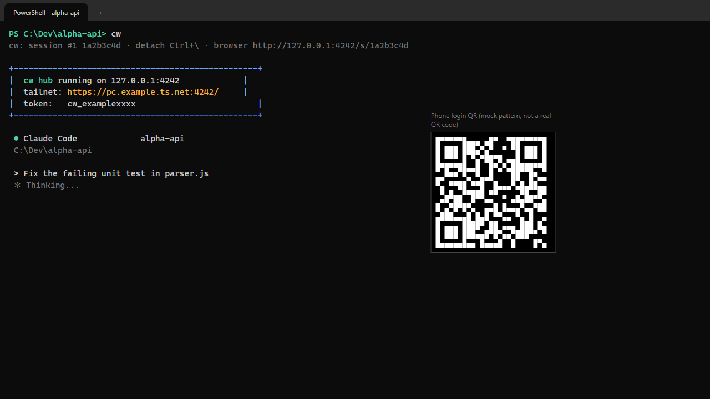
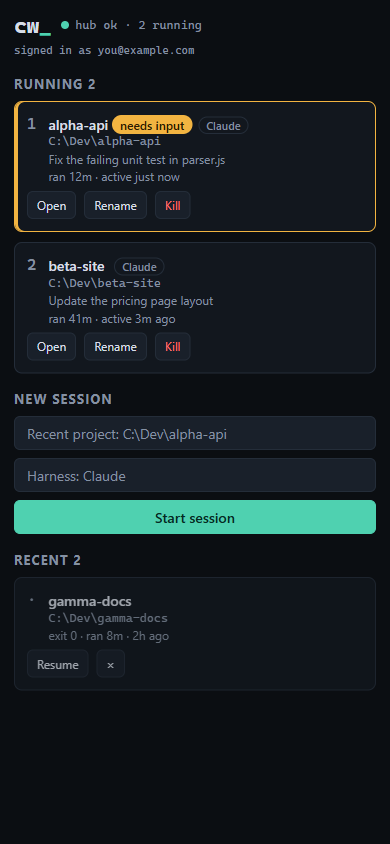
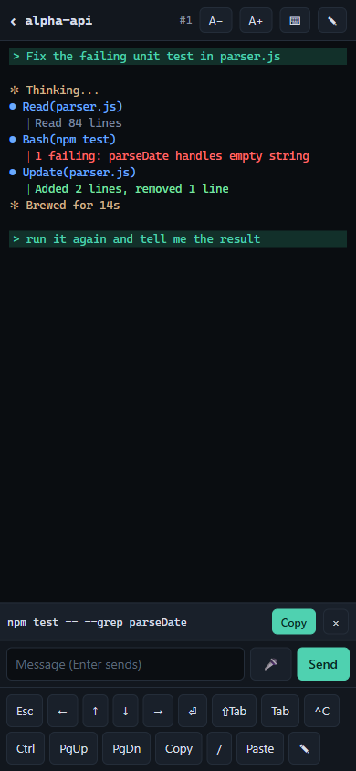
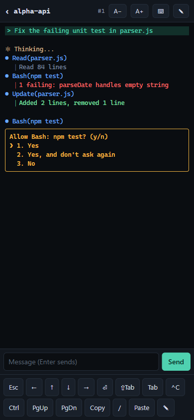
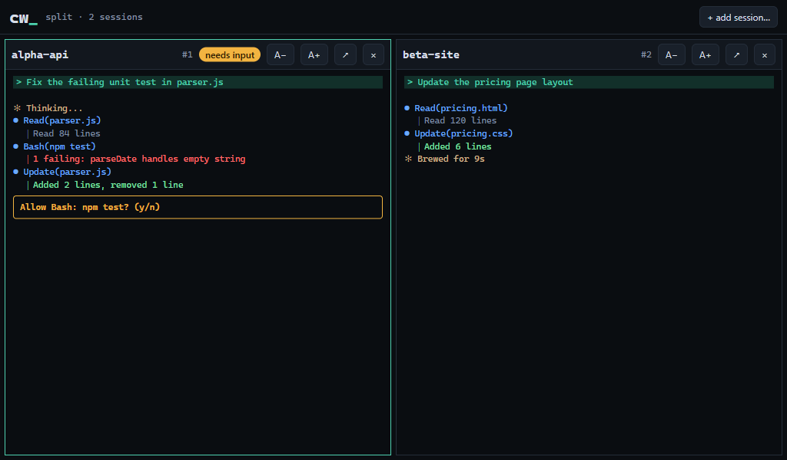
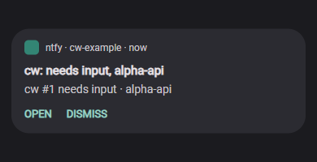

# How to use claude-web (`cw`)

Task-oriented guide. For installation see [INSTALL.md](../INSTALL.md); for every option and setting see the [README](../README.md). The screenshots are mock-ups with made-up data, not real captures.

## Start a session

1. Open Windows Terminal in your project folder.
2. Run `cw`. To give Claude a first prompt, run `cw "fix the tests"`.
3. Claude runs inside the hub and fills your terminal, with the same keys as running `claude` directly.
4. Detach with `Ctrl+\`. The session keeps running in the hub.

Other agents: `cw --harness codex` or `cw --harness gemini`. A different command: `cw -- pwsh -NoLogo`.

## See it on the phone

1. Make sure Tailscale is set up (see [INSTALL.md](../INSTALL.md), step 6) and the phone has the Tailscale app signed in.
2. Open your bookmark (or run `cw url --qr` on the PC and scan the first QR code once).
3. The list shows running sessions, and ones waiting for input are marked. Tap a session to open its terminal.

## Send text and keys from the phone

1. Open a session. The key bar sits at the bottom: Esc, arrows, Enter, Tab, `^C`, Ctrl, PgUp/PgDn, Copy, Paste.
2. Tap the pencil button to open the compose box, type a message and tap **Send** (Enter also sends; Shift+Enter inserts a new line).
3. Swipe the terminal to scroll back; PgUp/PgDn page through it.
4. On phones the bars hide themselves a few seconds after your last tap. Tap or swipe the handle at the top to bring them back.

## Approve a permission prompt from the phone

1. When Claude asks for permission, the session shows a prompt such as `Allow Bash: npm test? (y/n)` and, if the hooks are installed, you get a "needs input" push.
2. Tap the notification (it opens the session) or open the session from the list.
3. Answer it like in a desktop terminal; the web UI has no separate approve button. Either use the key bar's arrow keys to move to an option and press its Enter key (the return arrow), or open the compose box (pencil button), type the answer the prompt asks for (for example a number or `y`) and tap **Send**, which types the text and then presses Enter. Esc on the key bar cancels.

## Resume or kill a session

1. In the terminal: `cw ls` lists running and recent sessions.
2. End a running one with `cw kill <n>`.
3. Continue a finished one with `cw resume <n|id>`. Resume needs the hooks, which record Claude's session id.
4. On the phone: use **Kill** on a running row and **Resume** on a recent row.
5. Sessions end when the hub stops, so they show as recent afterwards.

Rename with `cw rename <n|id> <title...>`, or tap the title on the session page.

## Split view

1. At a desk, open the hub in a browser with `cw --web` (it prints the URL), then go to the list page.
2. Press **Split view**, tick up to four running sessions and press **Open split**.
3. Click a pane to type there. Drag the dividers to resize. Press the arrow button on a pane to open it in its own tab, or the cross to close the pane (the session keeps running).

Split view is a desk feature and is hidden on phones and narrow windows.

## Copy snippets

Agent CLIs hard-wrap long lines, so copying a command out of the terminal can break it. Use the snippet tray instead.

1. Ask the agent to run `cw copy --label <short> '<exact text>'` when it gives you a command. You can add this line to `CLAUDE.md`: `When you give the user a command or code to run, also run cw copy --label <short> '<exact text>'.`
2. On the phone a chip appears above the key bar with a **Copy** button.
3. Tap **Copy**. (Clipboard access needs the `https://...ts.net:4242` address.)

For other terminal text, tap **Copy** in the key bar or long-press the terminal to open the copy overlay.

## Notifications and sounds

1. Run `cw hooks install` once on the PC.
2. In the ntfy app, subscribe to both topics from `cw url --qr`: "needs input" and "finished".
3. Run `cw notify test` to check.
4. For different sounds, open each topic in the ntfy app, go to its notification settings and pick a sound per topic.
5. Optional: set `"notifyIdle": true` in `~/.cw/config.json` for low-priority "idle" reminders.

## Talk and voice mode

1. Dictation: the compose box has a microphone button. Hold it to talk on a phone, release, check the text and tap **Send**.
2. Talk mode: tap the speaker button in the title bar, then hold **Hold to talk**. Your words are typed into the session, and Claude's final reply is read aloud.
3. Both need the `https://...ts.net:4242` address for the microphone, and a one-time setup of the speech tools on the PC (see "Voice dictation" and "Talk mode" in the README). Talk replies also need `cw hooks install`.

## Troubleshooting

**Hub not running.** `cw hub status` shows whether it is up. Running `cw` starts it. If it will not start, port 4242 may be taken (`netstat -ano | findstr :4242`; `CW_PORT` changes the port) or check `~/.cw/hub.log`. If you use autostart, `Start-ScheduledTask cw-hub` restarts it.

**Token rejected (401).** The cookie is not set or the token was removed. Run `cw url --qr` and open the login link again over https. Check `hub.log` for `auth failed`.

**Tailscale 403 or 421.**
- 421 means the address is not on the hub's allowlist. Use the full `https://<pc>.<tailnet>.ts.net:4242` name, not an IP or a short name.
- 403 means the page's Origin does not match; open cw from its own URL.
- 401 with Tailscale login enabled means your account is not allowed: run `cw auth tailscale list`, then `cw auth tailscale add <login>` with the login shown in `hub.log`.
- If nothing loads at all, turn on "Use Tailscale DNS" in the phone's Tailscale app.

**ntfy is silent.** Run `cw notify test`. If it does not arrive, check that the phone is subscribed to the topics printed by `cw url`. If test works but real events do not, run `cw hooks install` again. If only one kind arrives, you are subscribed to one of the two topics only.

More in the README troubleshooting table.
